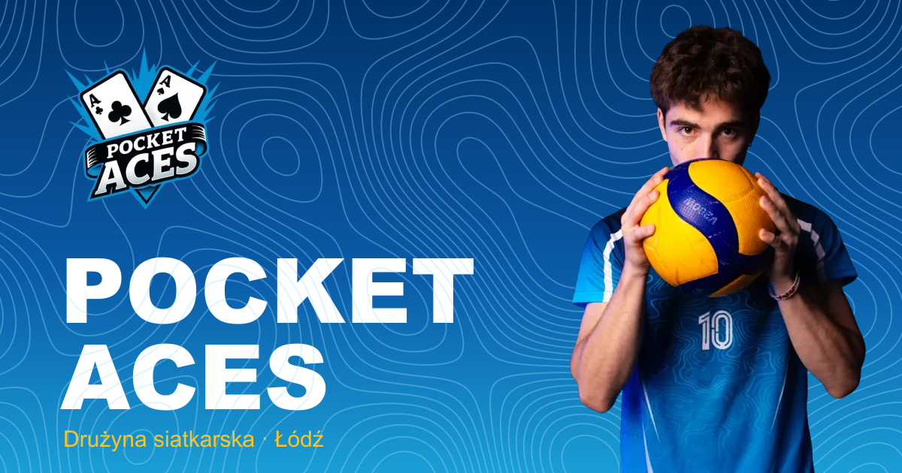
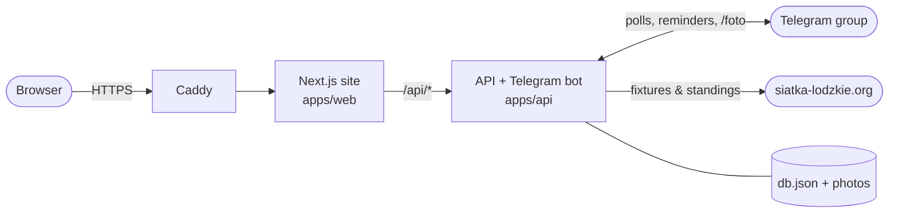

<div align="center">



# Pocket Aces 🏐

**The home of the Pocket Aces volleyball team from Łódź.**

The site and Telegram bot run the team's week: trainings, league matches, lineups, stats and our own tournament.

[](https://nextjs.org)
[](https://react.dev)
[](https://tailwindcss.com)
[](https://nodejs.org)
[](https://grammy.dev)
[](https://hono.dev)
[](DEPLOY.md)

</div>

---

## ✨ Features

### 🃏 Website

- **Hero and roster.** Every player has a playing card with their number, position and photo.
- **Player profiles.** `/team/[number]` shows season totals and points per match on a chart.
- **Season leaders** for points, aces and blocks.
- **Match center.** `/mecz` shows the next match with score, lineup and a court diagram, plus a photo gallery from games.
- **League table.** The official standings from siatka-lodzkie.org, with our row highlighted.
- **Calendar export.** `.ics` feeds for every match, for a single match and for trainings.
- **Pocket Aces Cup:**
  - registrations and a countdown;
  - group draw, round-robin tables and the playoff bracket.
- **Languages:** 🇵🇱 Polish and 🇬🇧 English.

### 🤖 Telegram bot

- **Training polls.** The bot posts a poll for each training, sends reminders and keeps attendance stats.
- **League sync.** Fixtures are pulled from the league site automatically: hourly, and every 15 minutes on Wednesdays, when match times usually change.
- **Match polls** go out on Thursday at 10:00. Reminders follow the evening before and 3 hours before the game.
- **Rescheduling.** When a match moves, the group gets a warning.
- **Match photos.** Send photos with the caption `/foto` and they appear on the site.

### 🔐 Player hub and captain panel

- **Login with Telegram.** Only members of the team group can get in.
- **Player hub.** Each player sees their own attendance, who's coming to the next training, and the team's attendance leaders.
- **`/admin` captain panel.** Captains can edit:
  - results, sets and player stats;
  - photos;
  - tournament settings, payment status, the draw and game results.

## 🏗️ Architecture



The site and API share one domain: Next.js rewrites `/api/*` to the API. That way the login cookies work without any CORS setup.

## 🚀 Quick start

You need **Node.js 24+** and a bot token from [@BotFather](https://t.me/BotFather).

```bash
# 1. API + bot
cd apps/api
npm install
cp .env.example .env      # put your BOT_TOKEN here
npm start                 # → http://localhost:4000/api

# 2. Website (in a second terminal)
cd apps/web
npm install
npm run dev               # → http://localhost:3000
```

## 🧪 Checks

```bash
cd apps/api && npm run check && npm test   # types + bot, league, cup and API tests
cd apps/web && npx tsc --noEmit && npm run lint && npm run build
```

## 🌍 Deploy

One command on any VPS, with HTTPS from Caddy:

```bash
echo "SITE_DOMAIN=your-domain.pl" > .env
docker compose up -d --build
```

Step-by-step guide: **[DEPLOY.md](DEPLOY.md)**. The full list of bot commands is in **[apps/api/README.md](apps/api/README.md)**.

## 📁 Project structure

```text
Pocket-Aces/
├── apps/
│   ├── web/              Next.js 16 site (App Router, Tailwind 4, PL/EN)
│   │   └── src/
│   │       ├── app/        pages: /, /team, /team/[number], /mecz, /hub, /admin
│   │       ├── components/ cards, match center, cup, hub, captain panel
│   │       └── i18n/       dictionaries and language switch
│   └── api/              Node 24 API + grammY bot
│       └── src/
│           ├── bot/        commands, polls, reminders
│           ├── http/       Hono routes (public, hub, admin)
│           ├── league.ts   siatka-lodzkie.org fixtures and standings
│           └── cup.ts      tournament groups, tables and playoff
├── packages/shared/      shared volleyball stats helpers
├── docker-compose.yml    Caddy → web → api
└── DEPLOY.md
```

<div align="center">

**Made in Łódź by Pocket Aces 🂡**

</div>
